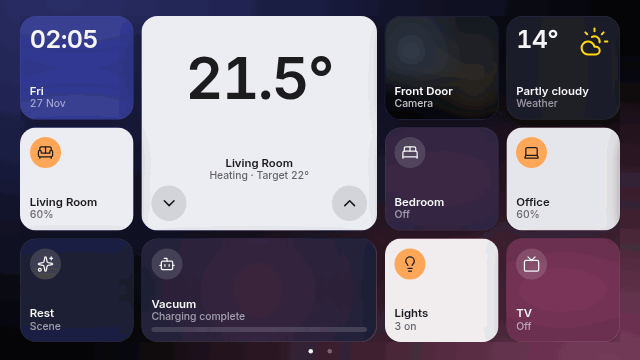

# Open HomeView



An Apple Home style wall dashboard for [Home Assistant](https://www.home-assistant.io/), built for a touch screen in landscape (1280×720). See all built-in widgets, standby faces, and themes in the [gallery](docs/gallery.md).

**[Try the live demo →](https://miladd3.github.io/open-homeview/)** It runs in your browser against a fake Home Assistant, so you can tap everything.

- **One container, one YAML file.** Rooms, scenes, apps, and entity IDs all live in `kiosk.yaml`. Edit it and the screen reloads by itself.
- **Your Home Assistant token never reaches the browser.** The container keeps the token and only lets the screen see and control the entities listed in `kiosk.yaml`.
- **Fast on a Raspberry Pi.** Taps update right away, and every theme ships a `lite` mode without blur effects for weak GPUs.

## Step 1: Install the server

Run Open HomeView in Docker on any machine that can reach Home Assistant (`amd64` and `arm64` images are published to GHCR).

Create a `compose.yaml` file:

```yaml
services:
  open-homeview:
    image: ghcr.io/miladd3/open-homeview:latest
    container_name: open-homeview
    restart: unless-stopped
    ports:
      - 8080:8080
    environment:
      HA_URL: http://homeassistant.local:8123
      HA_TOKEN: your-long-lived-access-token
    volumes:
      - ./config:/config
```

Start it with:

```bash
docker compose up -d
```

Then open `http://<server-ip>:8080`. Until you add `./config/kiosk.yaml`, the dashboard runs with the example config and shows a **kiosk.yaml** notice explaining what to do.

Need a token or your first `kiosk.yaml`? Follow [Getting started](docs/getting-started.md) to create a dedicated non-admin Home Assistant user, generate a long-lived access token, and write a minimal config. (You can also copy [`compose.yaml`](compose.yaml) and [`.env.example`](.env.example) from this repo.)

| Variable          | Default              | What it is                                                                                                              |
| ----------------- | -------------------- | ----------------------------------------------------------------------------------------------------------------------- |
| `HA_URL`          | (required)           | Your Home Assistant address                                                                                             |
| `HA_TOKEN`        | (required)           | Long-lived token of a non-admin HA user                                                                                 |
| `PORT`            | `8080`               | Port inside the container                                                                                               |
| `CONFIG_PATH`     | `/config/kiosk.yaml` | Where the container reads your config                                                                                   |
| `SCHEMA_ENTITIES` | `false`              | Suggest your HA entity IDs in the editor schema (see [Autocomplete](docs/configuration.md#autocomplete-in-your-editor)) |

## Step 2: Show it on a screen

- **Tablet, phone, or browser:** open `http://<server-ip>:8080` in any full-screen browser (for example, Safari/Chrome "Add to Home Screen" or Fully Kiosk Browser).
- **Dedicated Raspberry Pi wall screen:** follow the [Raspberry Pi kiosk guide](docs/raspberry-pi-kiosk.md) to boot straight into full-screen Chromium with `cage`.

## Security

- The page has **no login**. Keep it on your home network and never expose it to the internet without authentication in front of it.
- The HA token stays in the container. The browser connects to the container, which swaps in the token and drops any request for an entity that isn't in `kiosk.yaml` (no area or device targets either).
- The container only writes one file: `layout.yaml`, the on-screen dashboard layout. It never adds entities. Set `editPin` in `kiosk.yaml` if people you don't trust can reach the screen or your network.
- Use a dedicated **non-admin** HA user, so the token can't change Home Assistant's settings even if it leaks.

## Documentation

- [Getting started](docs/getting-started.md) — create an HA token, find entity IDs, write a minimal `kiosk.yaml`, edit on the screen, and put a reverse proxy in front.
- [Configuration](docs/configuration.md) — full `kiosk.yaml` reference, screens, editor autocomplete, and how the HA proxy works.
- [Runtime packs](docs/configuration.md#runtime-packs) — add extra app types, faces, or themes without rebuilding.
- [Raspberry Pi kiosk guide](docs/raspberry-pi-kiosk.md) — set up a Pi and touch display as a wall screen.
- [Gallery](docs/gallery.md) — every built-in app type, face, and theme.
- [Contributing](CONTRIBUTING.md) — local development, repo structure, and writing your own app types, faces, or themes.

## License

[MIT](LICENSE)
