# Gallery

Every app type, face and theme in `src/`, from each folder's `description` and `preview.png`.
Generated by `npm run gallery`. To add your own, see [CONTRIBUTING.md](../CONTRIBUTING.md).

## App types

| Name | Preview | What it is |
| --- | --- | --- |
| `camera` | 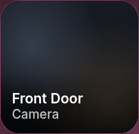 | A live camera, full screen. |
| `climate` | 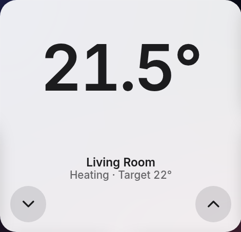 | A thermostat. The 2x2 size has buttons to change the target. |
| `clock` | 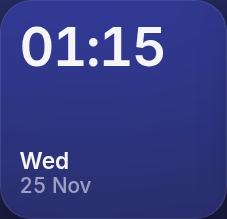 | The time and date. |
| `light` | 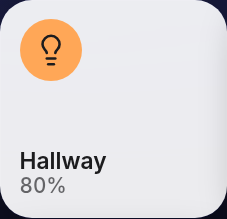 | One light: tap toggles it, long-press sets its brightness. |
| `lights` | 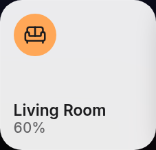 | Every light on its own, sorted into groups (usually rooms) with their scenes. |
| `lock` | 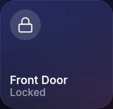 | A door lock: tap locks or unlocks it. |
| `scene` | 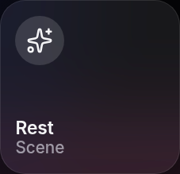 | Runs one scene. |
| `sensor` | 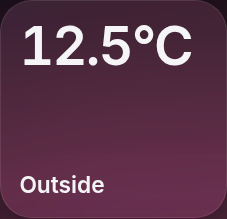 | One sensor reading. |
| `switch` | 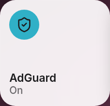 | Any on/off entity, with optional sensors. |
| `tv` | 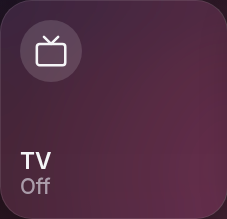 | A TV remote. |
| `vacuum` | 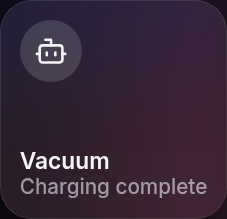 | A robot vacuum. |
| `weather` | 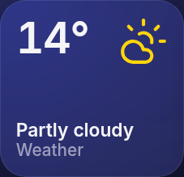 | The weather of kiosk.yaml's top-level `weather:` entity. |

## Faces

| Name | Preview | What it is |
| --- | --- | --- |
| `big-clock` | 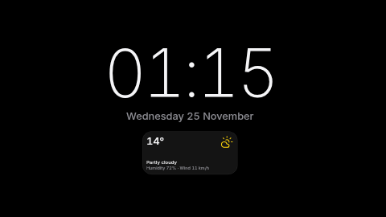 | The time and date, big, with one widget under them. |
| `home-modular` | 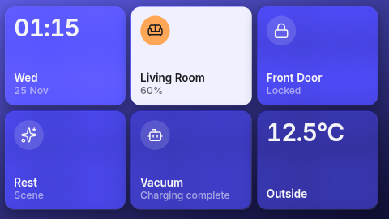 | Six widgets in two rows on a tinted background, to work the home from standby. |
| `modular` | 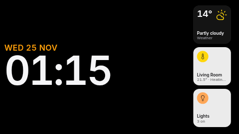 | The date and time on the left, three widgets on the right. |
| `night` | 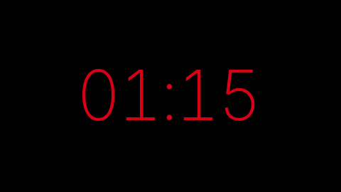 | Dim red digits on black, for night hours. |

## Themes

| Name | Preview | What it is |
| --- | --- | --- |
| `flat-light` | 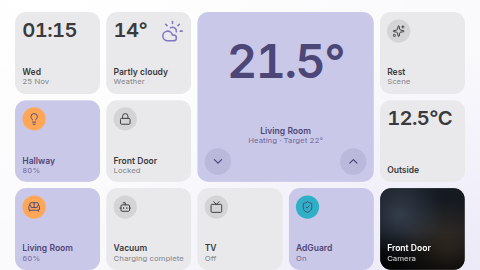 | Flat and light: grey widgets, lavender when on (the tint). |
| `glass` | 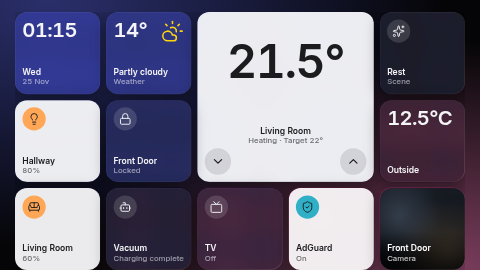 | Frosted glass over a dark wallpaper. |
| `liquid-glass` | 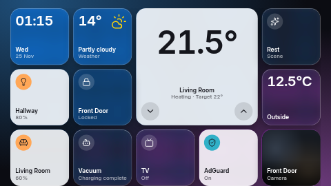 | Clear glass with bright edges, rounder corners and springy motion. |
